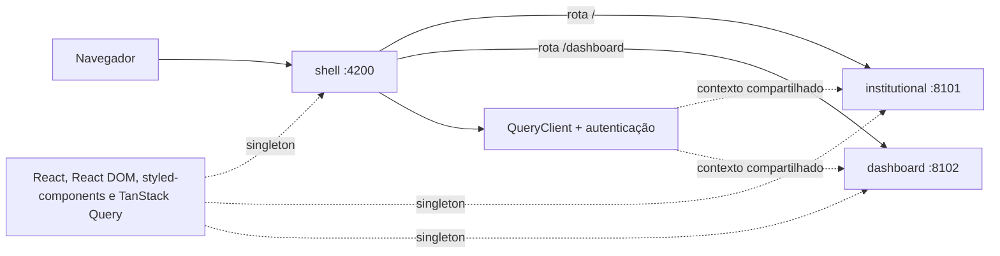
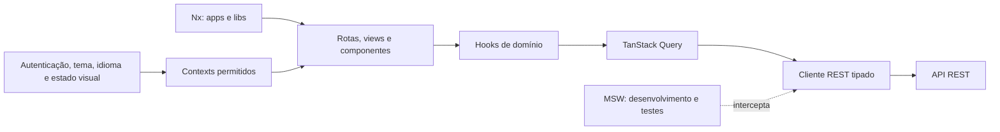
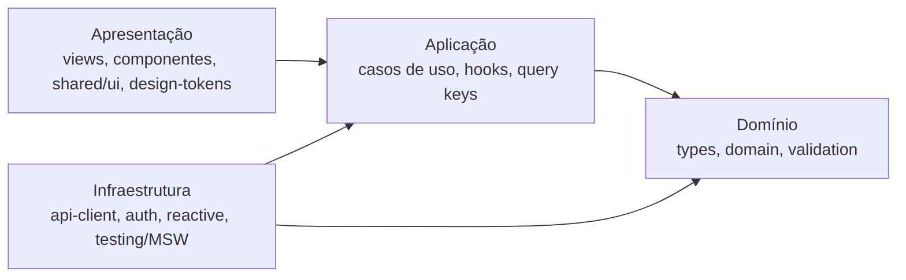
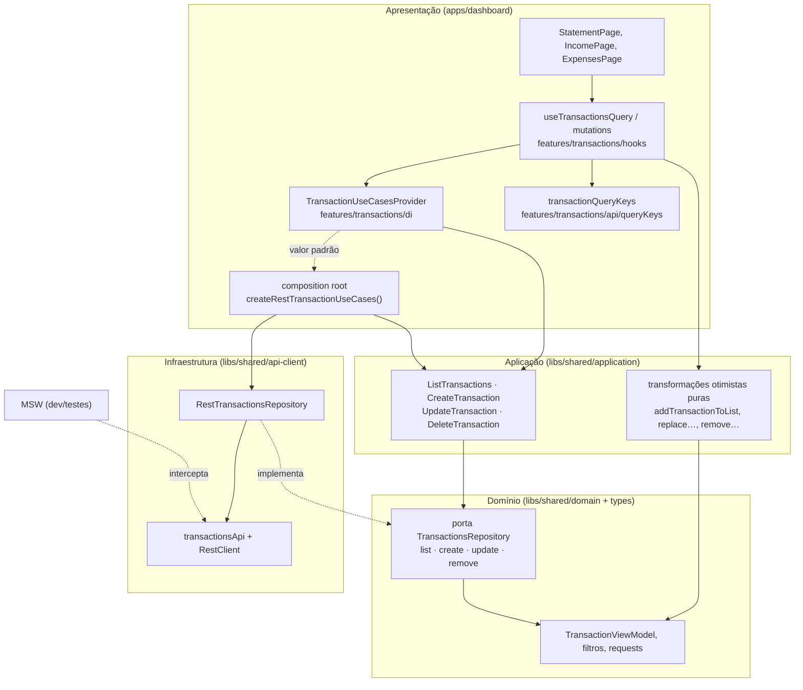

# Arquitetura do Tech Challenge

## Status

Este documento define a arquitetura alvo atualizada em 24 de julho de 2026. O fluxo de transações e a Home analítica seguem a arquitetura REST mockada com MSW e TanStack Query, sem dados remotos em Context. A landing page está no remote `institutional`; o dashboard e suas rotas estão no remote `dashboard`; o shell concentra a composição, o QueryClient e a autenticação.

## Decisões definitivas

- React 18 e Next.js 14 com App Router.
- Radix UI para primitivas acessíveis e `styled-components` para estilos.
- Jest e React Testing Library para testes.
- Context API somente para autenticação, tema, idioma e estado visual.
- TanStack Query para todo estado de servidor.
- Contratos REST simulados por MSW em desenvolvimento e testes.
- Sem Angular, Redux, Recoil ou GraphQL.
- Workspace Nx exclusivamente React/Next.js.
- Module Federation exclusivamente entre aplicações React standalone.
- `shell` como host/consumer, `institutional` e `dashboard` como remotes/providers.
- React, React DOM, styled-components e TanStack Query compartilhados como singletons, além de `@banking/shared/auth` e `@banking/shared/api-client` (estado de sessão em memória: access token, token anti-CSRF e refresh single-flight precisam ser a mesma instância no shell e nos remotes; os apps federados importam só a raiz de `api-client`, regra de lint).
- Um único `QueryClient` e uma única origem de autenticação no shell federado.

## Composição federada



O shell registra as URLs dos remotes em runtime e carrega somente o remote correspondente à rota atual. Cada carregamento possui estado acessível de progresso e fallback isolado com nova tentativa. A indisponibilidade de um remote não desmonta o shell nem impede o carregamento do outro.

As URLs padrão atendem o desenvolvimento local e podem ser substituídas no build/deploy:

| Variável | Padrão local |
| --- | --- |
| `INSTITUTIONAL_REMOTE_URL` | `http://127.0.0.1:8101/remoteEntry.js` |
| `DASHBOARD_REMOTE_URL` | `http://127.0.0.1:8102/remoteEntry.js` |

Cada aplicação possui targets próprios `serve`, `build`, `lint`, `typecheck` e `test`. Os builds dos remotes publicam `remoteEntry.js` e tipos federados sem depender do build do shell.

## Visão geral



A UI renderiza os estados fornecidos pelos hooks de domínio. Esses hooks encapsulam queries e mutations, enquanto o cliente REST concentra URL, método, serialização e tratamento de erro. Em desenvolvimento e teste, o MSW intercepta a mesma interface HTTP que será atendida por uma API real.

## Limites de responsabilidade

| Camada | Responsabilidade | Não deve fazer |
| --- | --- | --- |
| `apps/banking/src/app` | Rotas, layouts, providers e boundaries do App Router | Armazenar dados remotos em estado local |
| `apps/shell` | Composição, roteamento dos remotes e providers globais federados | Implementar domínio de dashboard ou duplicar providers nos remotes |
| `apps/institutional` | Landing page e login federados, também executáveis standalone | Criar autenticação ou `QueryClient` próprios para a composição |
| `apps/dashboard` | Dashboard autenticado, rotas internas e análises financeiras | Duplicar autenticação, QueryClient ou cálculos de domínio na interface |
| `apps/banking/src/views` | Composição de páginas e estados de apresentação | Acessar fixtures ou implementar contratos HTTP |
| `apps/banking/src/components` | Composição de UI específica da aplicação | Conhecer MSW ou implementar contratos HTTP |
| hooks de domínio | Expor queries e mutations com uma API de uso previsível | Duplicar cache em Context |
| `libs/shared/ui` | Primitivas Radix UI, estilos e componentes reutilizáveis | Acessar data-access, auth ou testing |
| `libs/shared/types` | Tipos neutros de transação, categoria, filtros, ordenação e políticas de anexos | Depender de APIs de plataforma |
| `libs/shared/domain` | Moeda em centavos, datas, mapeamentos e agregações puras | Conhecer persistência, DOM ou UI |
| `libs/shared/validation` | Schemas Zod independentes de plataforma | Validar objetos específicos de web ou mobile |
| `libs/shared/design-tokens` | Cores, espaçamento, raios e tipografia primitivos | Expor CSS, `className` ou componentes |
| `libs/shared/application` | Casos de uso que dependem apenas das portas do domínio e transformações otimistas puras | Conhecer React, HTTP ou implementações concretas |
| `libs/shared/api-client` | Executar requests, traduzir erros de transporte e implementar portas (ex.: `RestTransactionsRepository`) | Controlar estado visual |
| `libs/shared/query` | Configuração comum do TanStack Query | Conhecer views ou mocks |
| `libs/shared/auth` | Context e contrato de autenticação global | Armazenar outros dados de servidor |
| `libs/shared/testing` | MSW, fixtures e setup de testes | Ser importado pelo bundle de produção, exceto o bootstrap de mocks em desenvolvimento |

## Modelo de estado

| Tipo de estado | Solução |
| --- | --- |
| Sessão e identidade usadas globalmente | Context de autenticação |
| Tema | Context de tema |
| Idioma e locale | Context de idioma |
| Sidebar, modal, tooltip e toast | Estado local ou Context visual próximo do consumidor |
| Transações, saldos, resumos, extratos e perfil remoto | TanStack Query |
| Loading, erro, retry e invalidação de recursos remotos | TanStack Query |
| Estado transitório de formulário | React Hook Form |

Não deve existir espelhamento de uma query em `useState`, `useReducer` ou Context. Estado derivado do servidor deve vir no contrato ou ser selecionado no hook da query apenas quando for uma transformação estritamente de apresentação.

## API REST mockada

O primeiro domínio migrado é transações. O contrato implementado inclui:

| Método e endpoint | Finalidade |
| --- | --- |
| `GET /api/transactions` | Lista de transações pronta para exibição |
| `POST /api/transactions` | Criação de uma transação |
| `PUT /api/transactions/:id` | Atualização integral de uma transação |
| `DELETE /api/transactions/:id` | Exclusão de uma transação |
| `GET /api/dashboard/summary` | Saldo, entradas e saídas agregados |
| `GET /api/dashboard/monthly` | Série mensal pronta para os gráficos |
| `GET /api/dashboard/home` | Indicadores, comparações, fluxo, categorias e transações recentes prontos para apresentação |

Os handlers do MSW devem:

- reutilizar os tipos dos contratos REST;
- responder com status HTTP coerentes, incluindo erros;
- manter fixtures fora dos componentes;
- ser usados por `setupServer` no Jest e por `setupWorker` somente em desenvolvimento;
- falhar em requests não tratados nos testes para evitar falsos positivos.

## Estrutura do workspace Nx

```text
apps/
|-- banking/                     # aplicação Next.js atual
|-- shell/                       # host React da federação
|-- institutional/               # remote React institucional
`-- dashboard/                   # remote React do dashboard
libs/
`-- shared/
    |-- ui/                      # Radix UI e styled-components
    |-- types/                   # tipos e políticas neutros
    |-- domain/                  # regras e transformações puras
    |-- validation/              # schemas Zod neutros
    |-- application/             # casos de uso (dependem só de portas do domínio)
    |-- design-tokens/           # tokens visuais primitivos
    |-- api-client/              # cliente HTTP tipado
    |-- query/                   # configuração TanStack Query
    |-- auth/                    # autenticação global
    `-- testing/                 # MSW, fixtures e setup Jest
```

Cada projeto possui `project.json`, tags de camada e targets de qualidade. Os aliases canônicos usam o prefixo `@banking/shared/*`. O alias `@/*` continua reservado ao código interno de `apps/banking/src`.

O ESLint aplica `@nx/enforce-module-boundaries` com as tags de camada da Clean Architecture (`layer:domain`, `layer:application`, `layer:infrastructure`, `layer:presentation`), descritas na seção "Fase 4 – arquitetura alvo". Os apps (`type:app`) são composition roots e podem consumir qualquer lib compartilhada.

O Module Federation conecta somente `shell`, `institutional` e `dashboard`. O app Next.js `banking` não participa do share scope e permanece disponível durante a migração incremental. Angular continua fora da arquitetura.

## Fluxo de consulta e mutação

1. A view chama um hook de domínio.
2. O hook usa uma query key centralizada e um caso de uso (no domínio de transações) ou o cliente REST (domínios ainda não migrados).
3. O MSW atende a chamada em desenvolvimento ou teste; em produção, a API real assume o mesmo contrato.
4. A query mantém cache, loading, erro e retry.
5. Uma mutation invalida ou atualiza somente as query keys afetadas.
6. A UI recebe dados prontos e mantém localmente apenas interação visual e formulário.

## Migração realizada

1. MSW configurado para navegador e Jest.
2. Contratos REST em `libs/shared/types` e cliente em `libs/shared/api-client`.
3. Fixtures, handlers MSW e setup Jest em `libs/shared/testing`.
4. Primitivas Radix UI e estilos compartilhados em `libs/shared/ui`.
5. Query client comum em `libs/shared/query` e autenticação em `libs/shared/auth`.
6. Query keys, queries e mutations centralizadas por domínio no app.
7. Views consumindo estados de loading, erro, vazio e sucesso pelos hooks.
8. `TransactionsContext` e dados locais de transações removidos.
9. Resumos, valores formatados e séries mensais entregues prontos pela API mockada.
10. Invalidação das listas e agregados coberta por testes de integração.
11. Shell e remotes React configurados com Module Federation dinâmico.
12. Singletons e providers globais centralizados no shell federado.
13. Loading, fallback acessível e retry cobertos por testes.
14. Desenvolvimento conjunto e builds independentes configurados no Nx.
15. Landing page migrada para `institutional` e dashboard completo migrado para `dashboard`.
16. Home autenticada com análises financeiras, estados de consulta e alternativas tabulares acessíveis.
17. Tipos e regras multiplataforma separados entre `types`, `domain`, `validation` e `design-tokens`, com persistência monetária em `amountInCents`.

Cada etapa deve manter lint, typecheck, testes e build verdes.

## Fase 4 – arquitetura alvo

Decisões registradas em 17 de novembro de 2026 para a Fase 4. O escopo é a web federada (`shell`, `institutional`, `dashboard` e `libs/shared/*`); `apps/mobile` e `apps/banking` ficam fora do escopo e apenas devem continuar verdes. Estas decisões descrevem o alvo; a implementação será incremental.

### Clean Architecture



| Camada | Projetos | Tag Nx | Regra |
| --- | --- | --- | --- |
| Domínio | `libs/shared/types`, `libs/shared/domain`, `libs/shared/validation` | `layer:domain` | Puro, sem React, DOM, rede ou storage; define as portas (ex.: `TransactionsRepository`) |
| Aplicação | `libs/shared/application`, `libs/shared/query` e hooks por feature nos apps | `layer:application` | Casos de uso que orquestram o domínio e dependem apenas das portas |
| Infraestrutura | `libs/shared/api-client`, `libs/shared/auth`, `libs/shared/reactive`, `libs/shared/security`, `libs/shared/testing` | `layer:infrastructure` | Implementa as portas (ex.: `RestTransactionsRepository`), transporte, sessão, criptografia (Web Crypto), streams e mocks |
| Apresentação | views e componentes dos apps, `libs/shared/ui`, `libs/shared/design-tokens` | `layer:presentation` | Consome casos de uso via hooks e provider de DI |

As dependências apontam para o domínio e são verificadas pelo `@nx/enforce-module-boundaries` em `eslint.config.js`:

| Origem | Pode depender de |
| --- | --- |
| `layer:domain` | `layer:domain` |
| `layer:application` | `layer:application`, `layer:domain` |
| `layer:infrastructure` | `layer:infrastructure`, `layer:application`, `layer:domain` |
| `layer:presentation` | `layer:presentation`, `layer:application`, `layer:domain` |

Assim, `domain -> application/infra` e `application -> infra` falham no lint. Os apps são composition roots (`type:app`) e são os únicos pontos que conhecem as implementações concretas das portas.

#### Domínio de transações (implementado)



- **Porta**: `TransactionsRepository` em `libs/shared/domain/src/ports` usa somente os contratos de `libs/shared/types`. O cancelamento é um `CancellationSignal` estrutural (um `AbortSignal` o satisfaz), para o domínio não depender de APIs de plataforma.
- **Casos de uso**: classes com `execute()` em `libs/shared/application/src/transactions`, montadas por `createTransactionUseCases(repository)`. Testadas com um repositório falso em memória, sem rede.
- **Infraestrutura**: `RestTransactionsRepository` adapta o `transactionsApi` existente; endpoints, contratos REST e handlers MSW não mudaram.
- **Injeção de dependência**: `TransactionUseCasesProvider` (Context) entrega somente objetos de serviço estáveis, nunca dados de servidor. O valor padrão vem do composition root REST, então views renderizadas sem o provider mantêm o comportamento; testes podem injetar casos de uso sobre um repositório falso.
- **Estado de servidor**: continua exclusivamente no TanStack Query; os hooks apenas trocam a chamada direta ao `api-client` pelo caso de uso.

#### Atualização otimista com rollback

Criar, editar e excluir transação (inclusive as mutations de submissão com anexos) seguem o ciclo:

1. `onMutate`: `cancelQueries(transactionQueryKeys.lists())`, snapshot de todas as listas em cache (`getQueriesData`) e aplicação da transformação otimista em cada uma.
2. `onError`: restaura o snapshot (rollback).
3. `onSettled`: invalida somente `transactionQueryKeys.all` e `dashboardQueryKeys.all`; a resposta da API substitui o valor provisório.

Regras das transformações (puras, em `libs/shared/application`): a criação entra no topo da primeira página apenas quando a lista usa a ordenação padrão e os filtros aceitam a transação; a edição substitui o item onde ele já aparece (preservando `attachmentCount`); a exclusão remove o item e decrementa `total`. Uma nova tentativa de upload com `persistedTransaction` não aplica atualização otimista. O view model provisório é gerado com `transactionToViewModel` do domínio. Durante a exclusão otimista, o `DeleteTransactionModal` permanece aberto enquanto a mutation está pendente, mesmo com a transação já fora da lista, para exibir o erro após o rollback.

Cobertura: testes de unidade dos casos de uso (repositório falso), testes de integração dos hooks com MSW (`useTransactions.optimistic.test.tsx`) e e2e na composição federada (`apps/shell-e2e/src/transactions.spec.ts`), que atrasa ou força erro nas respostas por meio dos headers `x-mock-delay-ms` e `x-mock-error` aceitos pelos handlers do MSW.

`transactionQueryKeys` é uma fábrica tipada derivada da raiz `["transactions"]` (`all > lists > list(filters)`), com tipos inferidos como tuplas `readonly` (`TransactionQueryKey`, `TransactionListQueryKey`) e o type guard `isTransactionListQueryKey` usado no rollback.

### Programação reativa

- RxJS é permitido somente em `libs/shared/reactive` (`@banking/shared/reactive`, projeto Nx `shared-reactive`, `layer:infrastructure`). A regra `no-restricted-imports` do `eslint.config.js` bloqueia `rxjs` e `rxjs/*` em qualquer outro caminho.
- A lib expõe hooks React ou funções com tipos próprios (`ReactiveSource`, `ReactiveObserver`, `ReactiveSubscription`); `Observable` não vaza para apps, UI ou domínio.
- API pública:
  - `useObservable` / `useObservableState`: assinam uma fonte durante o ciclo de vida do componente.
  - `createSearchStream` / `useSearchStream`: `debounceTime` → `distinctUntilChanged` → `switchMap` com `AbortSignal` (a execução anterior é abortada e seu resultado descartado).
  - `activity$` (mouse, teclado, roda, toque e retorno da aba via `visibilitychange`, com throttle) e o operador interno `idle(ms)`, exposto como `useIdle(ms)` para o logout por inatividade.
  - `online$` (`online`/`offline`), exposto como `useOnlineStatus()`.
- Extrato: `TransactionFilters` emite os valores brutos a cada alteração; `useTransactionFilterStream` estabiliza (400 ms, comparação pela query string) e só então atualiza a URL. A URL é a query key: o TanStack Query continua dono do cache e cancela a requisição HTTP obsoleta via `signal` quando a key muda. Submit e "Limpar filtros" aplicam na hora e também alimentam o stream, descartando valores pendentes.
- `DashboardLayout` exibe `OfflineBanner` (região `role="status"`) a partir de `online$`.
- O TanStack Query continua sendo o único cache de dados de servidor; streams servem a eventos (digitação, atividade, conectividade e, futuramente, eventos em tempo real e comunicação entre remotes).

### Performance

- Remotes carregados sob demanda por rota, com fallback acessível e retry (já existente).
- `React.lazy`/`import()` para rotas internas e componentes pesados dos remotes (gráficos, modais, formulários).
- Prefetch por intenção (hover/foco em navegação e rota provável seguinte): `queryClient.prefetchQuery` para dados e pré-carregamento do chunk ou `remoteEntry` correspondente.

### Cache por domínio no TanStack Query

Requisito atendido: "Implementar armazenamento em cache para otimizar requisições". A política fica centralizada em `libs/shared/query` (`cachePolicies`) e é aplicada nas `queryOptions` de cada feature (hooks e prefetch usam o mesmo objeto). Cada política também grava `meta.cacheDomain`, usado pela allowlist de persistência.

| Política (`cachePolicies.*`) | Query keys | `staleTime` | `gcTime` | Persistida | Observações |
| --- | --- | --- | --- | --- | --- |
| `categories` | `transactionQueryKeys.categories()` | 30 min | 24 h | Sim (localStorage) | Catálogo público quase estático; revalidado por ETag |
| `dashboard` | `dashboardQueryKeys.*` (home, resumo, mensal, perfil) | 1 min | 10 min | Não | Agregados invalidados por mutações de transações |
| `transactions` | `transactionQueryKeys.list(filtros)` e `attachmentList(id)` | 15 s | 5 min | Não | Mutações aplicam update otimista e invalidam `transactionQueryKeys.all` e `dashboardQueryKeys.all`; anexos são invalidados após upload/remoção |
| `session` | `["auth", "session"]` (`libs/shared/auth`) | 5 min | 30 min | Nunca | Espelha o cookie de sessão; login/logout reescrevem com `setQueryData` |

Os padrões do `createQueryClient` usam a política `transactions` (a mais conservadora) para qualquer query sem domínio explícito, mantêm `refetchOnWindowFocus: false` e nunca repetem mutações.

#### Retry inteligente

`shouldRetryQuery` e `queryRetryDelay` (`libs/shared/query/src/retry.ts`) são os padrões do QueryClient:

- respostas 4xx (validação, 401/403, 404, 409, 429) não são repetidas;
- 5xx e falhas de rede (erro sem `status`) são repetidas até 2 vezes, com backoff exponencial de 500 ms, 1 s (limite de 4 s);
- cancelamentos (`AbortError`) não são repetidos.

O status é lido de forma estrutural (qualquer erro com `status` numérico, como o `RestClientError`), para a camada de aplicação não depender da infraestrutura. Testes que exercitam estados de erro podem usar `createQueryClient({ queries: { retry: false } })`.

#### Persistência entre recargas

`enableQueryPersistence(queryClient, options)` (`libs/shared/query/src/persistence.ts`) usa `persistQueryClient` com `@tanstack/query-sync-storage-persister`:

- **Allowlist por domínio**: somente queries com `meta.cacheDomain` na allowlist e status `success` são desidratadas; mutações nunca são persistidas. Em texto claro (`PERSISTED_CACHE_DOMAINS`) só `categories` seria permitido; o shell usa apenas o storage cifrado, que admite também `dashboard`. Sessão e transações ficam só em memória.
- **Composition root**: o shell (dono do QueryClient único) injeta `window.localStorage` em `apps/shell/src/bootstrap.tsx` via `bindEncryptedQueryPersistence` (`apps/shell/src/session`), que restaura e passa a persistir quando a sessão é estabelecida. A lib não acessa APIs de plataforma diretamente; se o storage ou a Web Crypto estiverem indisponíveis, a aplicação segue sem persistência.
- **Invalidação**: `buster` (`QUERY_CACHE_BUSTER`) descarta o cache quando o formato muda; `maxAge` é igual ao `gcTime` de categorias (24 h), para que o dado restaurado não seja coletado antes do uso.
- **Criptografia (Fase 4, segurança)**: o shell usa `createAsyncStoragePersister` sobre o storage cifrado de `libs/shared/security` (AES-GCM, chave não extraível derivada por sessão) e a allowlist `ENCRYPTED_PERSISTED_CACHE_DOMAINS` (`categories` e `dashboard`). A persistência só existe enquanto há sessão e o blob é apagado no logout. Detalhes em `docs/AUDIT_ACCESSIBILITY_PERFORMANCE_SECURITY.md`.

#### Revalidação condicional (ETag)

O handler MSW de `GET /api/categories` responde com `ETag` (derivado de `mockCategoriesRevision`), `Cache-Control: private, no-cache` e `Access-Control-Expose-Headers: ETag`; se `If-None-Match` coincidir, devolve `304` sem corpo. O contrato `CategoryListResponse` não muda. No cliente, `RestClient.request(path, { conditional: true })` (só GET, opt-in, usado por `categoriesApi.list`) reenvia o último ETag e, em `304`, devolve o corpo já validado, mantido apenas em memória. Em uma API real cross-origin, `If-None-Match` dispara preflight CORS e o servidor precisa expor o header `ETag`.

#### Cobertura

- `libs/shared/query/src/cachePolicies.test.ts`: um dado não é refeito dentro do `staleTime` de cada domínio e é refeito depois dele.
- `libs/shared/query/src/retry.test.ts`: 4xx sem retry, 5xx/rede com até 2 retries e backoff.
- `libs/shared/query/src/persistence.test.ts`: a persistência grava e restaura apenas a allowlist, respeita o `buster` e aceita persister customizado.
- `apps/dashboard/src/features/transactions/api/queryOptions.test.tsx`: as `queryOptions` aplicam a política do domínio e remontar o hook de categorias dentro do `staleTime` não gera nova requisição.
- `libs/shared/testing/src/tests/api-infrastructure.test.ts`: ETag/`If-None-Match` com `304`.

Mutações atualizam ou invalidam explicitamente apenas as keys afetadas.

### Segurança

| Tema | Decisão |
| --- | --- |
| Tokens | Access token somente em memória no provider de autenticação do shell; nada em `localStorage`/`sessionStorage` |
| Refresh | Refresh token em cookie `HttpOnly`/`Secure`/`SameSite`; renovação silenciosa com deduplicação de requisições concorrentes e logout em caso de falha |
| CSRF | Token anti-CSRF enviado em header nas requisições mutáveis (double-submit) e validado pelos handlers do MSW |
| Criptografia | Somente Web Crypto API (`crypto.subtle`) para criptografia/hash no cliente; sem algoritmos ou bibliotecas próprias |
| Logs | Sem tokens, dados pessoais ou valores sensíveis em logs, URLs ou mensagens de erro |

O MSW deve simular os mesmos contratos de autenticação, refresh e CSRF esperados da API real.

### Artefatos gerados

`apps/shell/@mf-types` contém tipos federados gerados pelo plugin DTS do Module Federation a partir dos remotes. O shell não consome esses tipos no `typecheck` (usa `loadRemote` com tipos próprios); por isso a pasta está no `.gitignore` e não é versionada nem editada manualmente.
